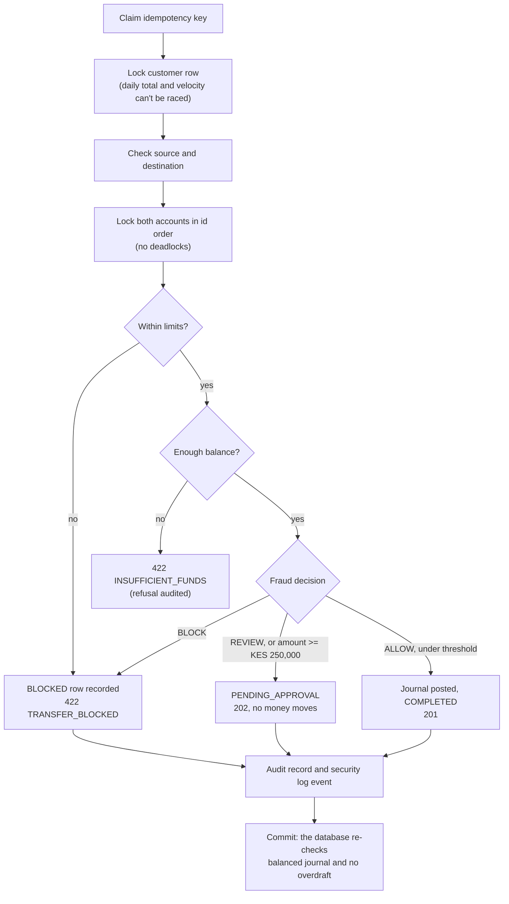
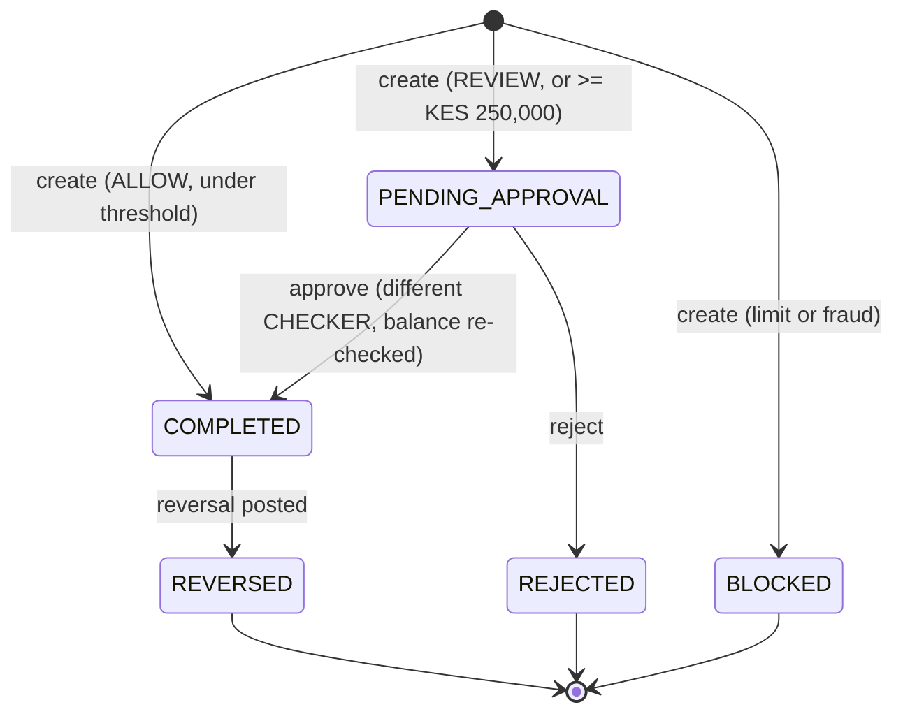
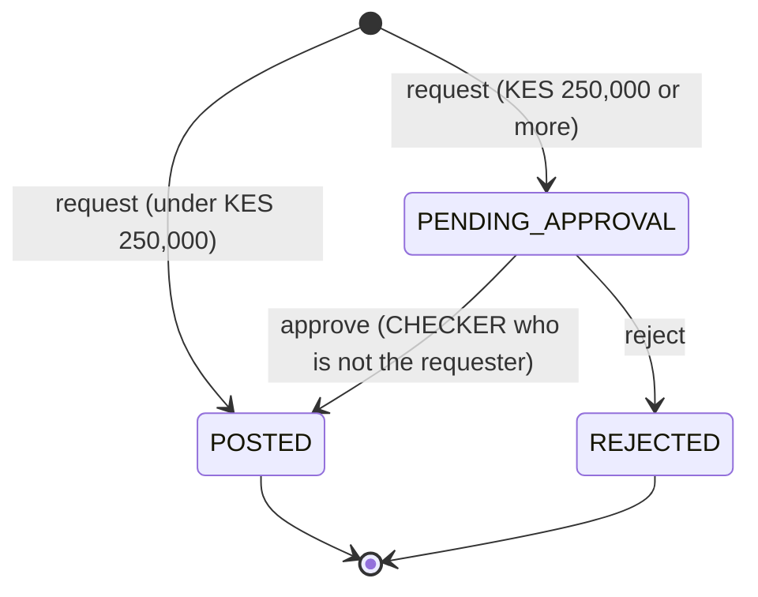

# JengaBank Payments API (v1)

A double-entry payments API for Kenyan shilling transfers. It has maker-checker approvals, fraud and limit controls, append-only ledgers, and a hash-chained audit trail.

Everything here is enforced in two places: in the application, and again in PostgreSQL through constraints and triggers. A bug in one layer never becomes a lost shilling.

> **Status:** this describes the `lead/transfers-reversals` branch. It assumes the approval-package update has landed: transfer approvals at `/api/v1/approvals`, and reversal approvals at `/api/v1/reversals`. The old `/api/v1/approvals/reversals/*` routes are removed.

---

## Contents

1. [Quick start](#1-quick-start)
2. [Conventions](#2-conventions)
3. [Authentication and roles](#3-authentication-and-roles)
4. [Idempotency](#4-idempotency)
5. [Errors](#5-errors)
6. [Rate limits and request limits](#6-rate-limits-and-request-limits)
7. [Endpoint summary](#7-endpoint-summary)
8. [Endpoints in detail](#8-endpoints-in-detail)
9. [Lifecycles](#9-lifecycles)
10. [Money-safety guarantees](#10-money-safety-guarantees)
11. [Error code catalogue](#11-error-code-catalogue)
12. [Configuration](#12-configuration)
13. [End-to-end demo script](#13-end-to-end-demo-script)

---

## 1. Quick start

```bash
docker compose up --build               # app on :8080, Postgres on host :5433
curl -s localhost:8080/healthz          # {"status":"UP"}
curl -s localhost:8080/readyz           # {"status":"READY"} once Flyway has migrated
```

Seeded users (passwords are shared in the team chat, never in the repo):

| Username       | Role     | Use it to                                      |
|----------------|----------|------------------------------------------------|
| `wanjiku`      | CUSTOMER | Send money                                     |
| `otieno`       | CUSTOMER | Receive money                                  |
| `ops.maker`    | MAKER    | Request reversals                              |
| `ops.checker`  | CHECKER  | Approve or reject transfers and reversals      |
| `ops.checker2` | CHECKER  | Second checker, for showing separation of duties |

---

## 2. Conventions

| Topic         | Rule |
|---------------|------|
| Base path     | `/api/v1` |
| Format        | JSON in and out (`Content-Type: application/json`). Unknown fields in a request body are rejected with `400 MALFORMED_REQUEST`. |
| Money         | Always an integer number of **minor units** (cents) in `amountMinor` / `balanceMinor`. `KES 1,250.50` is `125050`. Floats are never used. |
| Currency      | `KES` only. The API and the database both enforce it. |
| IDs           | UUID v4 strings. |
| Account numbers | 6 to 20 digits, as strings (they keep leading zeros). |
| Timestamps    | ISO-8601 with offset, for example `2026-10-13T09:15:22.481+03:00`. Business days follow **Africa/Nairobi**. |
| Pagination    | Keyset cursors. Every list returns `{ "items": [...], "nextCursor": "..." \| null }`. Pass `?cursor=<nextCursor>` for the next page. `limit` defaults to 50, minimum 1, maximum 100. Cursors are opaque, and a tampered cursor returns `400 INVALID_CURSOR`. |
| Ordering      | Lists are newest first, with a stable tiebreak on `id`. |

---

## 3. Authentication and roles

### Tokens

`POST /api/v1/auth/login` returns an **opaque bearer token**. The server stores only its SHA-256 hash in the `sessions` table, so a database leak exposes no usable tokens.

Send it on every call:

```
Authorization: Bearer <token>
```

- Tokens expire after **30 minutes** (`expiresAt` in the login response).
- `POST /api/v1/auth/logout` revokes the token on the server immediately.
- The web client keeps the token **in memory only**: never in `localStorage`, never in cookies. Because no cookies are involved, there is no CSRF surface.
- After **5 failed logins** an account locks for **15 minutes**. Login attempts are also rate limited per client IP.

### Roles

Each user has exactly **one** role.

| Role       | Who                | Can                                                                 |
|------------|--------------------|---------------------------------------------------------------------|
| `CUSTOMER` | Account holder     | See own accounts and entries, send transfers, see own transfers and incoming money |
| `MAKER`    | Operations staff   | See all transfers, request reversals, view audit and reconciliation |
| `CHECKER`  | Senior operations  | See all transfers, approve or reject pending transfers and reversals, run reconciliation, view audit |

Roles are enforced **twice**: by URL rules in `SecurityConfig`, and by `@PreAuthorize` on each controller method. A missing or invalid token returns `401`. A valid token with the wrong role returns `403`.

### Separation of duties

The person who created a transfer or requested a reversal can **never** decide it. The service checks this, and the database checks it again (`CHECK (decided_by <> created_by)` on `transfers`, `CHECK (decided_by <> requested_by)` on `reversals`).

---

## 4. Idempotency

Every request that moves money, or decides whether money moves, **requires** an `Idempotency-Key` header:

```
Idempotency-Key: 6f1c2a0e-8b0a-4d1e-9c55-2b7f3f0e4a11
```

| Situation                               | Result |
|-----------------------------------------|--------|
| New key                                 | The request runs. Its status code and body are stored with the key. |
| Same key, **same** request              | The **stored response is replayed** with its original status code. Nothing runs again. |
| Same key, **different** request         | `409 IDEMPOTENCY_CONFLICT` |
| Same key, original still in flight      | The second request waits on the row lock, then replays. In the rare case that it reads a key with no stored result yet, it gets `409 IDEMPOTENCY_IN_PROGRESS`. |
| Missing header                          | `400 MISSING_HEADER` |
| Not a UUID                              | `400 INVALID_IDEMPOTENCY_KEY` |

- Keys are scoped **per user**, so two users can never collide.
- A request is identified by SHA-256 of `METHOD path` plus the JSON body.
- The key is written **in the same database transaction** as the money movement. If the transfer fails and rolls back, the key rolls back too, so the client can safely retry with the same key.
- Clients should create a new key for each user intent (each click on "Send"), and reuse it on retries and network timeouts.

---

## 5. Errors

Every error uses the same shape:

```json
{
  "code": "INSUFFICIENT_FUNDS",
  "message": "There isn't enough money in this account.",
  "requestId": "b3f0c2d4-1a8e-4f7a-9d2c-5e6f7a8b9c0d",
  "reasons": ["optional", "list", "of", "details"]
}
```

- `code` is stable and meant for machines. `message` is plain language that is safe to show users.
- `requestId` matches the `requestId` in server logs. Quote it in a support ticket.
- `reasons` appears only when there is something to say. It is used for blocked transfers and validation failures.
- Errors never include stack traces, SQL, or internal class names.
- A record that doesn't exist and a record that isn't yours **both return `404`**, so nobody can probe for valid IDs.

See the [full catalogue](#11-error-code-catalogue).

---

## 6. Rate limits and request limits

| Scope                              | Limit                  | On breach |
|------------------------------------|------------------------|-----------|
| Login, per client IP               | 10 per minute          | `429 RATE_LIMITED` |
| Failed logins, per account         | 5, then a 15-minute lock | `423 ACCOUNT_LOCKED` |
| `GET /transfers`, per user         | 30 per minute          | `429 RATE_LIMITED` |
| `GET /reversals`, per user         | 30 per minute          | `429 RATE_LIMITED` |
| `GET /approvals`, per user         | 30 per minute          | `429 RATE_LIMITED` |
| `GET /accounts/{id}/entries`, per user | 30 per minute      | `429 RATE_LIMITED` |
| Transfer velocity, per customer    | 5 per 60 seconds       | `422 TRANSFER_BLOCKED` (recorded) |
| Unknown destination account numbers, per customer | 5 per 10 minutes | `429 RATE_LIMITED` (anti-enumeration; each miss is audited) |
| Request body size                  | 16 KB                  | `413 PAYLOAD_TOO_LARGE` |

The rate limiters are **backed by the database** with an atomic upsert, so limits hold across several app instances and restarts. Every limit hit is logged as `rate.limited`.

---

## 7. Endpoint summary

| Method | Path                                      | Roles            | Idempotency-Key | Purpose |
|--------|-------------------------------------------|------------------|-----------------|---------|
| GET    | `/healthz`                                | public           | No              | Liveness |
| GET    | `/readyz`                                 | public           | No              | Readiness (database and migrations) |
| POST   | `/api/v1/auth/login`                      | public           | No              | Get a token |
| POST   | `/api/v1/auth/logout`                     | any              | No              | Revoke the token |
| GET    | `/api/v1/me`                              | any              | No              | Current user |
| GET    | `/api/v1/accounts`                        | CUSTOMER         | No              | My accounts with live balances |
| GET    | `/api/v1/accounts/{id}`                   | CUSTOMER         | No              | One of my accounts |
| GET    | `/api/v1/accounts/{id}/entries`           | CUSTOMER         | No              | Ledger statement |
| POST   | `/api/v1/transfers`                       | CUSTOMER         | **Required**    | Send money |
| GET    | `/api/v1/transfers`                       | any              | No              | List transfers (scoped by role) |
| GET    | `/api/v1/transfers/{id}`                  | any              | No              | One transfer (scoped by role) |
| GET    | `/api/v1/approvals`                       | CHECKER          | No              | Transfers waiting for approval |
| POST   | `/api/v1/approvals/{id}/approve`          | CHECKER          | **Required**    | Approve a pending transfer |
| POST   | `/api/v1/approvals/{id}/reject`           | CHECKER          | **Required**    | Reject a pending transfer |
| POST   | `/api/v1/transfers/{id}/reversals`        | MAKER            | **Required**    | Request a reversal |
| GET    | `/api/v1/reversals`                       | MAKER, CHECKER   | No              | List reversals |
| GET    | `/api/v1/reversals/{id}`                  | MAKER, CHECKER   | No              | One reversal |
| POST   | `/api/v1/reversals/{id}/approve`          | CHECKER          | **Required**    | Approve a pending reversal |
| POST   | `/api/v1/reversals/{id}/reject`           | CHECKER          | **Required**    | Reject a pending reversal |
| GET    | `/api/v1/audit`                           | MAKER, CHECKER   | No              | Audit trail |
| GET    | `/api/v1/audit/verify`                    | MAKER, CHECKER   | No              | Verify the hash chain |
| POST   | `/api/v1/reconciliation/runs`             | CHECKER          | No              | Run reconciliation now |
| GET    | `/api/v1/reconciliation/runs/latest`      | MAKER, CHECKER   | No              | Latest reconciliation result |

---

## 8. Endpoints in detail

### 8.1 Health

#### `GET /healthz`
Liveness check. It never touches the database, so a slow database won't get the container restarted.
```json
200 {"status":"UP"}
```

#### `GET /readyz`
Readiness check. It verifies that the database answers and that Flyway has applied migrations.
```json
200 {"status":"READY"}
503 {"status":"NOT_READY"}
```
Both responses are `Cache-Control: no-store` and expose no version information.

---

### 8.2 Auth

#### `POST /api/v1/auth/login`
```json
{ "username": "wanjiku", "password": "••••••••" }
```
`200`
```json
{
  "token": "q3V9…opaque…",
  "expiresAt": "2026-10-13T10:45:00+03:00",
  "user": {
    "id": "00000000-0000-4000-8000-000000000001",
    "username": "wanjiku",
    "displayName": "Wanjiku Kamau",
    "roles": ["CUSTOMER"]
  }
}
```
| Status | Code                  | When |
|--------|-----------------------|------|
| 400    | `VALIDATION_FAILED`   | A field is blank or too long |
| 401    | `INVALID_CREDENTIALS` | Wrong username or password. The message is the same for both, so the response doesn't reveal which usernames exist. |
| 423    | `ACCOUNT_LOCKED`      | Too many failures. Wait 15 minutes. |
| 429    | `RATE_LIMITED`        | Too many attempts from this IP |

Passwords are hashed with BCrypt. Both the request and the response objects redact secrets in `toString()`, so secrets never reach the logs.

#### `POST /api/v1/auth/logout`
Revokes the current token. Returns `204` with no body.

#### `GET /api/v1/me`
```json
{ "id": "…", "username": "ops.checker", "displayName": "David Mwangi", "roles": ["CHECKER"] }
```

---

### 8.3 Accounts (CUSTOMER)

A customer only ever sees accounts they own. Anyone else's account ID returns `404`.

#### `GET /api/v1/accounts`
```json
{
  "items": [
    {
      "id": "1a2b…",
      "accountNumber": "100200300401",
      "name": "Everyday",
      "currency": "KES",
      "balanceMinor": 18425050,
      "status": "ACTIVE"
    }
  ],
  "nextCursor": null
}
```
`balanceMinor` is **derived**: it is `SUM(credits) - SUM(debits)` over the ledger and is recalculated on every read. No stored balance column exists that could drift.

`status` is one of `ACTIVE`, `FROZEN` or `CLOSED`.

#### `GET /api/v1/accounts/{id}`
Returns one `Account`, or `404`.

#### `GET /api/v1/accounts/{id}/entries`
The account statement, built straight from the ledger.
```json
{
  "items": [
    {
      "id": "…",
      "journalId": "…",
      "accountId": "1a2b…",
      "direction": "DEBIT",
      "amountMinor": 500000,
      "currency": "KES",
      "description": "Rent October",
      "createdAt": "2026-10-13T09:15:22+03:00"
    }
  ],
  "nextCursor": "MjAyNi0xMC0xM1Qw…"
}
```
Rate limited to 30 calls per minute per user.

---

### 8.4 Transfers

#### `POST /api/v1/transfers` (CUSTOMER, Idempotency-Key required)

```http
POST /api/v1/transfers
Authorization: Bearer <token>
Idempotency-Key: 6f1c2a0e-8b0a-4d1e-9c55-2b7f3f0e4a11
Content-Type: application/json

{
  "fromAccountId": "1a2b3c4d-…",
  "toAccountNumber": "100200300402",
  "amountMinor": 500000,
  "currency": "KES",
  "reference": "Rent October"
}
```

| Field             | Rule |
|-------------------|------|
| `fromAccountId`   | Required. Must be an `ACTIVE` account **you own**. Any other account returns `404`, and the attempt is logged as `authz.access.denied`. |
| `toAccountNumber` | Required, 6 to 20 digits. Must be an `ACTIVE` customer account other than the sender's. |
| `amountMinor`     | Required. Positive, at most `100000000000`. |
| `currency`        | Required. Must be `"KES"`. |
| `reference`       | Optional, at most 140 characters. Control characters are stripped. |

The customer never supplies who they are, a status, or a fee. Identity comes from the token, and everything else is decided on the server.

**What happens, all in one database transaction:**



**Responses**

| Status | Meaning |
|--------|---------|
| `201 Created`  | `COMPLETED`. The money has moved. |
| `202 Accepted` | `PENDING_APPROVAL`. A checker must approve. No money has moved. |
| `422`          | `TRANSFER_BLOCKED` (limit or fraud, with `reasons`), `INSUFFICIENT_FUNDS`, `INVALID_DESTINATION`, `SAME_ACCOUNT` or `ACCOUNT_NOT_ACTIVE` |
| `404`          | The source account isn't yours, or doesn't exist |
| `429`          | `RATE_LIMITED`: more than 5 unknown destination account numbers in 10 minutes |
| `409`          | `IDEMPOTENCY_CONFLICT` |

**Transfer object**
```json
{
  "id": "7d1e…",
  "fromAccountId": "1a2b…",
  "fromAccountNumber": "100200300401",
  "toAccountNumber": "100200300402",
  "amountMinor": 30000000,
  "currency": "KES",
  "reference": "Car deposit",
  "status": "PENDING_APPROVAL",
  "fraud": {
    "decision": "REVIEW",
    "reasons": [
      "Large amount to an account you haven't paid before",
      "Amount is KES 250,000 or more, so a second person must approve it"
    ]
  },
  "journalId": null,
  "createdBy": "wanjiku",
  "createdAt": "2026-10-13T09:15:22+03:00",
  "approvedBy": null,
  "approvedAt": null,
  "rejectionReason": null,
  "reversalJournalId": null
}
```

**Blocked example**
```json
422
{
  "code": "TRANSFER_BLOCKED",
  "message": "This transfer is over a limit.",
  "requestId": "…",
  "reasons": ["Above the daily limit of KES 2,000,000"]
}
```
Blocked attempts are **stored** with status `BLOCKED` and audited. They count toward velocity and fraud history, so an attacker can't probe limits for free.

**Limits (G7)**

| Limit                 | Default         | Notes |
|-----------------------|-----------------|-------|
| Per transfer          | KES 1,000,000   | |
| Daily total           | KES 2,000,000   | Counts `COMPLETED` and `PENDING_APPROVAL`. Resets at **midnight Nairobi time** (21:00 UTC). |
| Velocity              | 5 per 60 seconds | Counts every attempt, including blocked ones |

**Fraud rules (baseline engine)**

The rules are explainable, and each one produces a readable reason. Any BLOCK wins, otherwise any REVIEW, otherwise ALLOW.

| Rule                                   | Outcome |
|----------------------------------------|---------|
| 3 or more blocked attempts in the last 10 minutes | BLOCK |
| KES 100,000 or more to a payee you have never paid (no completed or reversed transfer to them) | REVIEW |
| KES 50,000 or more between 00:00 and 04:59 Nairobi time | REVIEW |

The decision is made **before** the transfer row is written. A database trigger makes `fraud_decision` and `fraud_reasons` **immutable** afterwards.

#### `GET /api/v1/transfers`
Query parameters: `status` (one of `COMPLETED`, `PENDING_APPROVAL`, `REJECTED`, `BLOCKED`, `REVERSED`), `cursor`, `limit`.

**Visibility rule**

| Caller            | Sees |
|-------------------|------|
| CUSTOMER          | Transfers they created, **plus** incoming transfers that actually arrived (`COMPLETED` or `REVERSED`). Never someone else's pending or blocked attempt. |
| MAKER, CHECKER    | All transfers |

Rate limited to 30 calls per minute per user.

#### `GET /api/v1/transfers/{id}`
Same visibility rule. A transfer you can't see returns `404`, the same response as one that doesn't exist, and is logged as `authz.access.denied`.

---

### 8.5 Transfer approvals (CHECKER)

#### `GET /api/v1/approvals`
The checker queue: every `PENDING_APPROVAL` transfer, newest first. Same paged shape as `GET /transfers`. Rate limited to 30 calls per minute.

#### `POST /api/v1/approvals/{transferId}/approve` (Idempotency-Key required)
Body: `{}`, or empty.

Funds are **not reserved** while a transfer is pending. When the checker approves, the system:
1. locks the transfer and both accounts,
2. **re-checks the sender's balance**, and
3. posts the journal and sets the transfer to `COMPLETED`.

| Status | Code                 | When |
|--------|----------------------|------|
| 200    | n/a                  | Approved. Returns the transfer with `status: COMPLETED`, `approvedBy` and `journalId`. |
| 403    | `SELF_APPROVAL`      | You created this transfer |
| 404    | `NOT_FOUND`          | No such transfer |
| 409    | `INVALID_STATE`      | Already approved or rejected |
| 422    | `INSUFFICIENT_FUNDS` | The sender spent the money while the transfer waited. The transfer stays pending, so reject it. |

#### `POST /api/v1/approvals/{transferId}/reject` (Idempotency-Key required)
```json
{ "reason": "Customer could not confirm on callback" }
```
`reason` must be 5 to 280 characters. Returns `200` with `status: REJECTED` and `rejectionReason`. No money moves. The other errors are the same as for approve.

---

### 8.6 Reversals (G5)

A reversal **never edits or deletes** the original transfer. It posts a **new journal** with the entries swapped (debit the receiver, credit the sender), linked through `journals.reversal_of`. That column is `UNIQUE`, so the database guarantees a journal can be reversed at most once.

| Amount               | Path |
|----------------------|------|
| Under KES 250,000    | The MAKER request posts immediately: `201`, `POSTED` |
| KES 250,000 or more  | `202`, `PENDING_APPROVAL`. A CHECKER **who isn't the requester** must approve. |

#### `POST /api/v1/transfers/{transferId}/reversals` (MAKER, Idempotency-Key required)
```json
{ "reason": "Customer paid the wrong account, confirmed by phone" }
```
`reason` must be 10 to 280 characters. It goes on the audit trail.

| Status | Code                          | When |
|--------|-------------------------------|------|
| 201    | n/a                           | Posted (under the threshold) |
| 202    | n/a                           | Waiting for a checker |
| 404    | `NOT_FOUND`                   | No such transfer |
| 409    | `REVERSAL_EXISTS`             | The transfer is already reversed, or a reversal is waiting for approval |
| 422    | `REVERSAL_NOT_ALLOWED`        | The transfer isn't `COMPLETED` (for example `PENDING_APPROVAL`, `REJECTED` or `BLOCKED`) |
| 422    | `REVERSAL_INSUFFICIENT_FUNDS` | The receiver no longer holds enough to give back |

**Reversal object**
```json
{
  "id": "c0ff…",
  "transferId": "7d1e…",
  "status": "PENDING_APPROVAL",
  "reason": "Customer paid the wrong account, confirmed by phone",
  "amountMinor": 30000000,
  "fromAccountNumber": "100200300401",
  "toAccountNumber": "100200300402",
  "journalId": null,
  "requestedBy": "ops.maker",
  "requestedAt": "2026-10-13T11:02:10+03:00",
  "decidedBy": null,
  "decidedAt": null
}
```

#### `GET /api/v1/reversals` (MAKER, CHECKER)
Query parameters: `status` (one of `PENDING_APPROVAL`, `POSTED`, `REJECTED`), `cursor`, `limit`. Rate limited to 30 calls per minute.

#### `GET /api/v1/reversals/{id}` (MAKER, CHECKER)

#### `POST /api/v1/reversals/{id}/approve` (CHECKER, Idempotency-Key required)
Locks the reversal, the transfer and both accounts. It then re-checks the receiver's balance, posts the swapped journal, and marks the reversal `POSTED` and the transfer `REVERSED`.

| Status | Code              | When |
|--------|-------------------|------|
| 200    | n/a               | Posted |
| 403    | `SELF_APPROVAL`   | You requested this reversal |
| 409    | `INVALID_STATE`   | Already decided |
| 422    | `REVERSAL_NOT_ALLOWED`, `REVERSAL_INSUFFICIENT_FUNDS` | The original changed, or the receiver no longer has the funds |

#### `POST /api/v1/reversals/{id}/reject` (CHECKER, Idempotency-Key required)
```json
{ "reason": "Customer withdrew the complaint" }
```
`reason` must be 5 to 280 characters. No money moves, and the transfer stays `COMPLETED`. A new reversal can be requested later.

---

### 8.7 Audit (MAKER, CHECKER)

Every state change writes one `audit_log` row **in the same transaction** as the change. If the change rolls back, so does its audit record.

A database trigger assigns `sequence`, `prev_hash` and `hash = SHA-256(sequence, ts, actor, action, target, details, prev_hash)` under an advisory lock. The result is a single, strictly ordered hash chain.

`UPDATE`, `DELETE` and `TRUNCATE` on `audit_log` are **blocked by triggers**.

#### `GET /api/v1/audit`
```json
{
  "items": [
    {
      "sequence": 1042,
      "ts": "2026-10-13T11:05:44+03:00",
      "actor": "ops.checker",
      "action": "approval.approved",
      "target": "reversal/c0ff…",
      "hash": "9f2c…",
      "prevHash": "41ab…"
    }
  ],
  "nextCursor": "…"
}
```

#### `GET /api/v1/audit/verify`
Recomputes every hash from the first row to the last.
```json
{ "valid": true, "checked": 1042, "brokenAtSequence": null, "verifiedAt": "2026-10-13T11:06:00+03:00" }
```
If someone with database access edits a row by bypassing the triggers, `valid` becomes `false` and `brokenAtSequence` points at the first bad row. The check is logged as `audit.chain.ok` or `audit.chain.broken`.

---

### 8.8 Reconciliation

Independent proofs that the books are correct. A scheduled run happens at **23:00 Nairobi time** every day, and a checker can trigger one on demand.

#### `POST /api/v1/reconciliation/runs` (CHECKER)
#### `GET /api/v1/reconciliation/runs/latest` (MAKER, CHECKER)
```json
{
  "id": "…",
  "runAt": "2026-10-13T23:00:00+03:00",
  "status": "PASSED",
  "checks": [
    { "name": "ledger.conservation",       "passed": true, "detail": "credits minus debits across the whole ledger = 0" },
    { "name": "ledger.journals_balanced",  "passed": true, "detail": "journals where debits <> credits = 0" },
    { "name": "transfers.match_journals",  "passed": true, "detail": "posted transfers whose journal doesn't match = 0" },
    { "name": "reversals.linked",          "passed": true, "detail": "reversed transfers without a matching reversal journal = 0" },
    { "name": "accounts.no_overdrafts",    "passed": true, "detail": "accounts below zero = 0" },
    { "name": "audit.chain_intact",        "passed": true, "detail": "records checked = 1042" }
  ]
}
```
`status` is `PASSED` only if every check passes.
Run results are append-only, with the same trigger protection as the audit log. A failing run is logged as `reconciliation.failed`.

---

## 9. Lifecycles

### Transfer



A database trigger allows **only** these moves: `PENDING_APPROVAL -> COMPLETED | REJECTED` and `COMPLETED -> REVERSED`. Core fields (parties, amount, creator, fraud decision) can never change, and transfers can never be deleted.

### Reversal


Only `PENDING_APPROVAL` can change, and reversals can never be deleted.

---

## 10. Money-safety guarantees

These are the guarantees we claim, and how each one is enforced.

| # | Guarantee | Application | Database (backstop) | Proven by |
|---|-----------|-------------|---------------------|-----------|
| 1 | No overspend, even under concurrency | Customer row lock, then account locks in id order, then balance check | Deferred trigger: no `allow_negative = false` account below zero at commit | `TransferConcurrencyIT`: 20 parallel KES 10,000 transfers against KES 96,000; exactly 9 succeed |
| 2 | Every journal balances | `LedgerService.post` refuses unbalanced lines | Deferred trigger: sum of debits = sum of credits per journal | `LedgerIntegrityIT` |
| 3 | The whole ledger nets to zero | Double entry only | Reconciliation check | `TransferConcurrencyIT`, reconciliation |
| 4 | History is immutable | No update or delete code paths | Triggers block `UPDATE`/`DELETE`/`TRUNCATE` on journals, entries, audit and reconciliation runs | `LedgerIntegrityIT` |
| 5 | Exactly-once money movement | `IdempotencyService` in the same transaction | `PRIMARY KEY (user_id, idem_key)` | `TransferConcurrencyIT.sameIdempotencyKeyPostsExactlyOnce` |
| 6 | Four-eyes on large amounts | `SELF_APPROVAL` check | `CHECK (decided_by <> created_by)` | `ApprovalAndReversalIT` |
| 7 | Reversed at most once | `REVERSAL_EXISTS` / `REVERSAL_NOT_ALLOWED` | `journals.reversal_of UNIQUE` | `ApprovalAndReversalIT` |
| 8 | Tamper-evident audit | Written in the same transaction | Hash chain plus append-only triggers | `/audit/verify` |
| 9 | No cross-customer data leaks | Ownership in every query; `404` for not-yours | n/a | `AuthAndAccountsIT`, `TransferConcurrencyIT.cannotSendFromSomeoneElsesAccount` |

**Accepted residual risk:** the app connects as one database role that owns the tables. Triggers block tampering through the app, and the audit hash chain **detects** direct tampering by anyone holding the owner role. This is recorded in the risk register.

---

## 11. Error code catalogue

| HTTP | Code | Meaning |
|------|------|---------|
| 400 | `VALIDATION_FAILED` | A body field failed validation. `reasons` lists the fields. |
| 400 | `INVALID_PARAMETER` | A bad query or path parameter, such as an unknown `status` filter |
| 400 | `MALFORMED_REQUEST` | Not JSON, or it contains unknown fields |
| 400 | `MISSING_HEADER` | A required header (for example `Idempotency-Key`) is missing |
| 400 | `INVALID_IDEMPOTENCY_KEY` | The key isn't a UUID |
| 400 | `INVALID_CURSOR` | The page cursor is malformed or was tampered with |
| 401 | `UNAUTHENTICATED` | No token, or the token is expired or revoked |
| 401 | `INVALID_CREDENTIALS` | Login failed |
| 423 | `ACCOUNT_LOCKED` | Too many failed logins |
| 403 | `FORBIDDEN` | Wrong role |
| 403 | `SELF_APPROVAL` | You can't decide your own request |
| 404 | `NOT_FOUND` | Doesn't exist, or isn't yours |
| 405 | `METHOD_NOT_ALLOWED` | |
| 409 | `IDEMPOTENCY_CONFLICT` | The key was reused for a different request |
| 409 | `IDEMPOTENCY_IN_PROGRESS` | The original request is still running |
| 409 | `INVALID_STATE` | Already decided, or changed by a concurrent request |
| 409 | `REVERSAL_EXISTS` | The transfer already has a live reversal |
| 409 | `CONCURRENT_UPDATE` / `CONFLICT` | A database uniqueness or serialisation conflict |
| 413 | `PAYLOAD_TOO_LARGE` | The body is over 16 KB |
| 415 | `UNSUPPORTED_MEDIA_TYPE` | Not `application/json` |
| 422 | `TRANSFER_BLOCKED` | Over a limit, or blocked by fraud rules (see `reasons`) |
| 422 | `INSUFFICIENT_FUNDS` | Not enough money (at creation or at approval) |
| 422 | `INVALID_DESTINATION` | Unknown or inactive destination account |
| 422 | `SAME_ACCOUNT` | The source and destination are the same |
| 422 | `ACCOUNT_NOT_ACTIVE` | The source account is frozen or closed |
| 422 | `REVERSAL_NOT_ALLOWED` | Only `COMPLETED` transfers can be reversed |
| 422 | `REVERSAL_INSUFFICIENT_FUNDS` | The receiver can't give the money back |
| 422 | `RULE_VIOLATION` | A database guard rejected the change (the backstop fired) |
| 429 | `RATE_LIMITED` | Slow down: login, list endpoints, or too many unknown destination account numbers |
| 500 | `INTERNAL_ERROR` | Unexpected. Quote the `requestId`. |

---

## 12. Configuration

All of these live in `application.yml` and can be overridden with environment variables. Amounts are in minor units.

| Property | Default | |
|----------|---------|-|
| `jengabank.approval.threshold-minor` | `25000000` | KES 250,000. Applies to both transfers and reversals. |
| `jengabank.limits.max-per-transfer-minor` | `100000000` | KES 1,000,000 |
| `jengabank.limits.daily-total-minor` | `200000000` | KES 2,000,000, on the Nairobi day |
| `jengabank.limits.velocity-max-transfers` | `5` | |
| `jengabank.limits.velocity-window-seconds` | `60` | |
| `jengabank.auth.login-rate-per-minute` | `10` | Per client IP |
| `jengabank.auth.max-failed-logins` | `5` | |
| `jengabank.auth.lockout-minutes` | `15` | |
| `jengabank.auth.token-ttl-minutes` | `30` | |
| `jengabank.security.transfers-list-rate-per-minute` | `30` | |
| `jengabank.security.reversals-list-rate-per-minute` | `30` | |
| `jengabank.security.approvals-list-rate-per-minute` | `30` | |
| `jengabank.security.account-entries-rate-per-minute` | `30` | |
| `jengabank.security.max-request-bytes` | `16384` | |
| `jengabank.security.trusted-proxies` | empty | Only these peers may set `X-Forwarded-For` |
| `jengabank.reconciliation.cron` | `0 0 23 * * *` | Nairobi time |

---

## 13. End-to-end demo script

A five-minute walkthrough of every control. It needs `curl` and `jq`, and passwords from `SETUP.md`.

```bash
API=http://localhost:8080/api/v1
login() { curl -s $API/auth/login -H 'Content-Type: application/json' \
            -d "{\"username\":\"$1\",\"password\":\"$2\"}" | jq -r .token; }
key()   { cat /proc/sys/kernel/random/uuid; }

CUST=$(login wanjiku "$WANJIKU_PW")
MAKER=$(login ops.maker "$MAKER_PW")
CHK=$(login ops.checker "$CHECKER_PW")

FROM=$(curl -s $API/accounts -H "Authorization: Bearer $CUST" | jq -r '.items[0].id')
TO=<otieno's account number>

# 1. Small transfer -> 201 COMPLETED
curl -s $API/transfers -H "Authorization: Bearer $CUST" -H "Idempotency-Key: $(key)" \
  -H 'Content-Type: application/json' \
  -d "{\"fromAccountId\":\"$FROM\",\"toAccountNumber\":\"$TO\",\"amountMinor\":500000,\"currency\":\"KES\",\"reference\":\"Lunch\"}" | jq .status

# 2. Replay the same key -> identical response, no double debit
K=$(key)
for i in 1 2; do curl -s $API/transfers -H "Authorization: Bearer $CUST" -H "Idempotency-Key: $K" \
  -H 'Content-Type: application/json' \
  -d "{\"fromAccountId\":\"$FROM\",\"toAccountNumber\":\"$TO\",\"amountMinor\":100000,\"currency\":\"KES\"}" | jq -c '{id,status}'; done

# 3. Large transfer -> 202 PENDING_APPROVAL, then a checker approves
T=$(curl -s $API/transfers -H "Authorization: Bearer $CUST" -H "Idempotency-Key: $(key)" \
  -H 'Content-Type: application/json' \
  -d "{\"fromAccountId\":\"$FROM\",\"toAccountNumber\":\"$TO\",\"amountMinor\":30000000,\"currency\":\"KES\"}" | jq -r .id)
curl -s -X POST $API/approvals/$T/approve -H "Authorization: Bearer $CHK" -H "Idempotency-Key: $(key)" | jq .status

# 4. Maker requests a reversal -> 202, so a checker must approve it
R=$(curl -s $API/transfers/$T/reversals -H "Authorization: Bearer $MAKER" -H "Idempotency-Key: $(key)" \
  -H 'Content-Type: application/json' -d '{"reason":"Customer paid the wrong account"}' | jq -r .id)
curl -s -X POST $API/reversals/$R/approve -H "Authorization: Bearer $CHK" -H "Idempotency-Key: $(key)" | jq .status

# 5. Customer tries a staff endpoint -> 403
curl -s -o /dev/null -w '%{http_code}\n' $API/approvals -H "Authorization: Bearer $CUST"

# 6. Prove the audit chain is intact
curl -s $API/audit/verify -H "Authorization: Bearer $CHK" | jq
```
