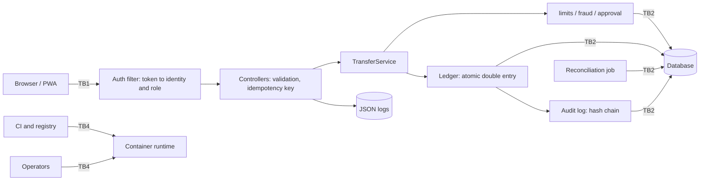

# Threat Model: JengaBank Payments (APP04)

| Field            | Value                                                                                                                                                                        |
| ---------------- | ---------------------------------------------------------------------------------------------------------------------------------------------------------------------------- |
| Owner            | Security Lead                                                                                                                                                                |
| Version          | 1.1                                                                                                                                                                          |
| Date             | 13 Oct 2026                                                                                                                                                                  |
| Method           | STRIDE; 5x5 likelihood/impact scoring (NIST SP 800-30, ISO/IEC 27005); OWASP API Security Top 10 (2023)                                                                      |
| Related          | `security-objectives.md`, `security-test-plan.md`, `log-actions.md`, `risk-register.md`, `live-defence-runbook.md`                                                           |

## 1. Executive summary

APP04 is a payments processing application that moves money between accounts using a double-entry ledger. Customers create transfers; fraud and limit rules decide whether a transfer completes, is blocked, or waits for a checker's approval; makers reverse completed transfers; checkers approve, reject and run reconciliation; every state change is written to structured logs and a hash-chained audit log.

Key risks: double spend/idempotency races (T11–T13), IDOR/role escalation (T7, T8), reversal/approval abuse (T17, T20, T21), invalid amounts (T15), and audit tampering (T23). Threats map to objectives in `security-objectives.md`, tests in `security-test-plan.md`, and events in `log-actions.md`.

## 2. Scope

**In scope:** REST API (`/api/v1`), health/OpenAPI endpoints, React SPA/PWA, database, authentication/token handling, ledger, transfers, idempotency, reversals, limits, fraud, approvals, audit chain, reconciliation, logging, Docker image, CI.

**Out of scope:** host OS, network provider/network-layer DDoS, physical security, third-party payment rails.

## 3. Assumptions

Each assumption is verified against the running build and recorded as passed or failed.

| ID  | Assumption                                                                                                         |
| --- | ------------------------------------------------------------------------------------------------------------------ |
| AS1 | Session tokens are opaque random values generated in `SessionService`; only SHA-256 hashes are stored in the `sessions` table, and revocation/expiry are enforced server-side. They are not JWTs [A] |
| AS2 | TLS terminates in front of the app in production; the application receives plain HTTP internally and does not enforce HSTS itself [A] |
| AS3 | Database credentials and the signing key come from environment or secret store, not the image [A]                  |
| AS4 | One or more app instances serve concurrent requests; the database provides row locks or serializable isolation [A] |
| AS5 | Seed and demo users exist for the defence [A]                                                                      |
| AS6 | Only CUSTOMER can create transfers, per the endpoint contract                                                      |
| AS7 | The application DB role owns the tables; triggers block direct audit-row mutation and the hash chain detects bypasses [A] |

## 4. System architecture

### 4.1 Components

React SPA/PWA (browser); REST API (auth filter, controllers, services); limits/fraud/approval modules; double-entry ledger; idempotency store; hash-chained audit log; reconciliation job; relational database; structured JSON logs; CI pipeline; container runtime.

### 4.2 Data-flow diagram

### 4.3 Trust boundaries

| ID | Boundary | Notes |
|---|---|---|
| TB1 | Browser to API | All input is untrusted |
| TB2 | API to database | Injection, privilege and integrity boundary; app DB role privileges matter |
| TB3 | Service to service (`TransferService` to limits, fraud, approval, audit) | Internal contracts |
| TB4 | Build pipeline and operators to running container | Image integrity, secrets, console access |
| TB5 | Staff roles to customer data | Role separation |
| TB6 | Application to log sink | Log integrity and injection |

### 4.4 Data flows

| ID | Flow | Data |
|---|---|---|
| DF1 | Login | Credentials to token |
| DF2 | Account, entry and transfer reads | Ownership-filtered data |
| DF3 | Transfer creation | Amount, accounts, Idempotency-Key |
| DF4 | Approval and rejection | Transfer state change |
| DF5 | Reversal | Reversal journal |
| DF6 | Audit write and verify | Hash chain |
| DF7 | Reconciliation | Aggregates |
| DF8 | Logging | Security events |

### 4.5 Entry points

Public: `GET /healthz`, `GET /readyz`, `GET /openapi.json`, `POST /api/v1/auth/login`. `/swagger-ui` is disabled in the deployed image. Authenticated: the remaining 23 endpoints in the contract (customer, maker and checker routes). Other surfaces: the PWA and its service worker, the container and CI, the database, and any framework defaults (actuator, consoles).

## 5. Assets

| ID | Asset | Security need | Impact if compromised |
|---|---|---|---|
| A1 | Ledger entries and balances | Integrity, availability | Money created, destroyed or double-spent |
| A2 | Transfer, journal and idempotency records | Integrity | Lost evidence; broken reversals and reconciliation |
| A3 | Credentials and password hashes | Confidentiality | Account takeover |
| A4 | Auth tokens | Confidentiality, integrity | Impersonation with full user authority |
| A5 | Audit log and hash chain | Integrity | Every other control loses its evidence |
| A6 | Customer account data | Confidentiality | Privacy breach |
| A7 | Application availability | Availability | Missed Healthy submission or failed live defence |
| A8 | Secrets and configuration (DB credentials, signing key) | Confidentiality | Forged tokens, full compromise |
| A9 | Application logs | Integrity, confidentiality | Detection and forensics lost; secrets leaked |
| A10 | Approval and limit configuration | Integrity | Controls silently weakened |
| A11 | Container image, dependencies, CI | Integrity | Code execution, backdoor |

## 6. Threat actors

| ID | Actor | Capability | Motivation |
|---|---|---|---|
| TA1 | Anonymous attacker or bot | Network access, automation; reaches public endpoints only | Account takeover, data theft, disruption |
| TA2 | Malicious CUSTOMER | Valid token; tries IDOR, replay, races, amount abuse | Steal, double-spend, bypass limits, read others' data |
| TA3 | Compromised customer account | Stolen credentials or token | Fraudulent transfers |
| TA4 | Malicious MAKER | Staff role; reversal power | Fraudulent reversals |
| TA5 | Malicious CHECKER | Approval and reconciliation power | Self-approve, approve fraud, falsify reconciliation |
| TA6 | Colluding MAKER and CHECKER | Both roles | Defeat the four-eyes control |
| TA7 | Insider with DB, code or CI access | High trust | Alter ledger, audit log or image |
| TA8 | Supply chain attacker | Dependency or image compromise | Code execution |

## 7. Risk scoring

Likelihood (L) and Impact (I) are rated High, Medium or Low and scored High = 5, Medium = 3, Low = 1. Score = L x I.

| Score | Rating |
|---|---|
| 20 to 25 | Critical |
| 10 to 19 | High |
| 5 to 9 | Medium |
| 1 to 4 | Low |

Scores are **inherent** (before controls). **Residual** is the expected rating once the listed controls are implemented and the linked tests pass. The scale is a decision aid, not a measurement. Any residual rated High or Critical needs a named approver in `risk-register.md`.

## 8. Threat register

Columns: STRIDE category, actor, likelihood / impact, inherent score, required mitigation, log event that should fire, test ID, security objective, residual rating. Test IDs are defined in `security-test-plan.md` and events in `log-actions.md`.

### 8.1 Authentication and session

| ID | STRIDE | Threat | Actor | L / I | Score | Mitigation | Events | Tests | SO | Residual |
|---|---|---|---|---|---|---|---|---|---|---|
| T1 | Spoofing | Credential brute force or stuffing on `/auth/login` | TA1 | H / H | 25 Critical | Account lockout, rate limiting [G1], BCrypt with adequate cost | `auth.login.failed`, `auth.account.locked`, `rate.limited` | AT-01, RL-01 | SO-17, SO-19 | Medium |
| T2 | Information disclosure | Username enumeration through differing errors or timing | TA1 | H / M | 15 High | Identical response and timing for unknown user and wrong password [A] | `auth.login.failed` | AT-02 | SO-17 | Low |
| T3 | Denial of service | Lockout used to deny service to a victim | TA1, TA2 | M / M | 9 Medium | Time-boxed lockout; per-account and per-IP limits | `auth.account.locked` | AT-03 | SO-17 | Medium |
| T4 | Spoofing, Tampering | Random or modified token, revoked token, expired session, missing or malformed Authorization header, token in query string | TA1, TA2 | M / H | 15 High | Validate opaque server-side session tokens, revoke on logout, enforce expiry and reject invalid headers/query strings | `auth.token.invalid` | AT-04 | SO-11 | Low |
| T5 | Spoofing | Stolen token reused after logout | TA1, TA3 | M / H | 15 High | Short expiry plus server-side session revocation (sessions.revoke_at) on logout [G4]; DB-backed stateful sessions [A] | `auth.token.invalid`, `auth.logout` | AT-05 | SO-18 | Medium |
| T6 | Information disclosure | Token or credentials leaked in URLs, logs or error bodies | TA1, TA7 | M / H | 15 High | Header-only tokens, log redaction | — | LG-02 | SO-21 | Low |

### 8.2 Authorization

| ID | STRIDE | Threat | Actor | L / I | Score | Mitigation | Events | Tests | SO | Residual |
|---|---|---|---|---|---|---|---|---|---|---|
| T7 | Elevation of privilege | IDOR: a user reads another user's accounts, entries or transfers by changing an ID or pagination cursor | TA2 | H / H | 25 Critical | Ownership check on every protected read; 404 for non-owned resources [G10]; cursor tied to user and account | `authz.access.denied` | AZ-01 | SO-12 | Low |
| T8 | Elevation of privilege | Vertical escalation: CUSTOMER calls MAKER or CHECKER endpoints | TA2 | H / H | 25 Critical | Role checks from the token, deny by default | `authz.access.denied` | AZ-02 | SO-13 | Low |
| T9 | Elevation of privilege | Role or identity supplied in the request is trusted | TA2 | M / H | 15 High | Derive identity only from the token | `authz.access.denied` | AZ-03 | SO-14 | Low |
| T10 | Information disclosure | Staff list endpoints leak data beyond their intended scope | TA4, TA5 | M / M | 9 Medium | Define staff visibility explicitly and test it | `authz.access.denied` | AZ-04 | SO-37 | Low |

### 8.3 Transfers and ledger (highest risk)

| ID | STRIDE | Threat | Actor | L / I | Score | Mitigation | Events | Tests | SO | Residual |
|---|---|---|---|---|---|---|---|---|---|---|
| T11 | Tampering | Race condition: parallel transfers overdraw an account (double spend) | TA2 | H / H | 25 Critical | Row locks or serializable transactions; DB constraint on balance | `transfer.insufficient_funds` | CC-01 | SO-02, SO-03 | Low |
| T12 | Tampering | Replay of a transfer request | TA2, TA3 | H / H | 25 Critical | Mandatory Idempotency-Key; unique DB constraint scoped to user and endpoint [G2]; request hash stored | `idempotency.replayed`, `idempotency.conflict` | ID-01 to ID-04 | SO-04, SO-05 | Low |
| T13 | Tampering | Concurrent requests with the same key create two transfers | TA2 | M / H | 15 High | Atomic insert-or-fail on the key, not an in-memory check | `idempotency.replayed` | ID-05 | SO-06 | Low |
| T14 | Information disclosure | A user replays another's key and reads the stored response | TA2 | M / M | 9 Medium | Scope keys to user and endpoint [G2] | `idempotency.conflict` | ID-06 | SO-07 | Low |
| T15 | Tampering | Invalid amounts: zero, negative, overflow, decimals, wrong currency, same-account, missing destination | TA2 | H / H | 25 Critical | Strict validation of `amountMinor` (long) and `currency: "KES"`; overflow checks such as `Math.addExact` | `transfer.invalid_amount`, `request.invalid` | AM-01 to AM-06 | SO-08 | Low |
| T16 | Tampering | Debits do not equal credits after a partial failure | TA2, TA7 | M / H | 15 High | Single DB transaction; invariant tests; reconciliation | `reconciliation.failed` | LD-01 | SO-01, SO-02 | Low |
| T17 | Repudiation | Duplicate or concurrent reversal, or reversal of a non-COMPLETED transfer | TA4, TA2 | H / H | 25 Critical | State machine plus unique constraint of one reversal per journal entry | `reversal.duplicate_denied` | RV-01 to RV-03 | SO-09 | Low |
| T18 | Elevation of privilege | Reversal without authority, or by a maker on a transfer they initiated | TA4 | M / H | 15 High | Role check; separation of duties; KES 250,000+ reversal requires a different checker; below that threshold the maker can reverse and every reversal is audited | `authz.access.denied`, `reversal.created` | RV-05 | SO-15 | Medium |
| T19 | Tampering | Limit bypass by splitting transfers or racing the per-transfer, daily and velocity counters | TA2, TA3 | H / M | 15 High | Atomic counters, transactional limit checks, velocity and fraud rules | `limit.exceeded`, `fraud.review`, `fraud.block` | LM-01 to LM-03 | SO-10 | Medium |
| T39 | Tampering | Pending transfers exceed the balance because funds are not reserved while waiting for approval [G6] | TA2 | M / H | 15 High | Approval re-checks the sender balance and rejects with `INSUFFICIENT_FUNDS`; a database trigger also blocks overdrafts | `transfer.insufficient_funds` | MC-03 | SO-39 | Medium |
| T40 | Denial of service | Deadlock or 500 under opposing parallel transfers (A to B and B to A) | TA2 | M / M | 9 Medium | Consistent lock ordering | none | CC-01 | SO-40 | Low |
| T43 | Tampering | Daily limit window boundary abuse: Nairobi midnight (UTC+3) versus UTC midnight [G7] | TA2 | M / M | 9 Medium | Documented Nairobi-day window; boundary tests across 21:00 UTC | `limit.exceeded` | LM-02 | SO-43 | Low |

### 8.4 Maker-checker and fraud

| ID | STRIDE | Threat | Actor | L / I | Score | Mitigation | Events | Tests | SO | Residual |
|---|---|---|---|---|---|---|---|---|---|---|
| T20 | Elevation of privilege | Self-approval of one's own pending transfer | TA5, TA2 | H / H | 25 Critical | Reject when approver equals initiator | `approval.self_approval_denied` | MC-01 | SO-15 | Low |
| T21 | Tampering | Approve or reject a transfer already in a final state, or approve twice concurrently | TA5 | M / H | 15 High | State-machine guard plus locking; idempotency on approvals | `approval.approved`, `approval.rejected` | MC-02, MC-03 | SO-16 | Low |
| T22 | Tampering | Fraud rules bypassed through the REVIEW path, or REVIEW not routed to approval | TA2 | M / M | 9 Medium | Enforce the mapping ALLOW to 201, REVIEW to 202, BLOCK to 422 | `fraud.review`, `fraud.block` | FR-01 to FR-03 | SO-38 | Low |
| T41 | Denial of service | Flood of pending transfers clogs the checker queue | TA2 | M / M | 9 Medium | Per-user pending cap, velocity limits, rate limiting [G1] | `limit.exceeded`, `rate.limited` | RL-01, LM-03 | SO-41 | Medium |
| T42 | Elevation of privilege | Maker and checker collude to defeat four-eyes | TA6 | L / H | 5 Medium | Cannot be fully prevented: audit records initiator and approver, reconciliation, alerts, reversal caps | `approval.approved`, `reversal.created`, `reconciliation.failed` | LG-01, RC-01 | SO-42 | Medium |

### 8.5 Audit, reconciliation and logging

| ID | STRIDE | Threat | Actor | L / I | Score | Mitigation | Events | Tests | SO | Residual |
|---|---|---|---|---|---|---|---|---|---|---|
| T23 | Tampering, Repudiation | Insider edits or deletes audit rows | TA7 | M / H | 15 High | App DB role owns the tables; triggers block direct mutation, and the hash chain detects any bypass | `audit.chain.broken` | AU-01, AU-02 | SO-22, SO-23 | Low |
| T24 | Repudiation | Security-relevant actions not logged, or logs forged through CRLF injection | TA1, TA2 | M / M | 9 Medium | Structured JSON, input encoding, `requestId` on every entry, and the current event catalog in `Actions.java` | all shared events | LG-01, LG-02, LG-03 | SO-20, SO-21 | Low |
| T25 | Tampering | Reconciliation run is spoofed or its result hidden | TA5 | L / M | 3 Low | CHECKER-only access, audited, immutable results | `reconciliation.passed`, `reconciliation.failed` | RC-01 | SO-24 | Low |
| T44 | Repudiation | Logs lost on container restart | TA7 | M / M | 9 Medium | Log to stdout and persist to a volume or collector [A] | none | LG-04 | SO-44 | Medium |

### 8.6 Input handling, platform and frontend

| ID | STRIDE | Threat | Actor | L / I | Score | Mitigation | Events | Tests | SO | Residual |
|---|---|---|---|---|---|---|---|---|---|---|
| T26 | Tampering | SQL injection through path, query, body or header fields | TA1, TA2 | M / H | 15 High | Parameterised queries only; least-privilege DB role | `request.invalid` | IN-01 | SO-25 | Low |
| T27 | Denial of service, Tampering | Oversized or malformed bodies; unknown fields (mass assignment) | TA1, TA2 | H / M | 15 High | 16 KB cap; reject unknown fields; Bean Validation; DTOs separate from entities | `request.invalid` | IN-02, IN-03, IN-04 | SO-26 | Low |
| T28 | Denial of service | Request flooding on transfers or login | TA1 | H / M | 15 High | Login rate limiting implemented (per IP, per minute); general API rate limiting [G1] | `rate.limited` | RL-01 | SO-19 | Medium |
| T29 | Information disclosure | Verbose errors expose stack traces, SQL or framework banners | TA1 | M / M | 9 Medium | Uniform error body: `code`, `message`, `requestId` | `request.invalid` | IL-01 | SO-27 | Low |
| T30 | Information disclosure | Exposed debug or actuator endpoints, or an over-detailed `/openapi.json` | TA1 | M / M | 9 Medium | Disable or restrict; `/swagger-ui` is disabled in the deployed image while `/openapi.json` remains public by team decision and is reviewed as the public contract | none | IL-02 | SO-28 | Low |
| T31 | Tampering | XSS in Angular through free-text fields or unsafe bindings | TA2 | M / H | 15 High | No `innerHTML`, no sanitiser bypass; CSP | none | FE-01 | SO-30 | Low |
| T32 | Information disclosure | Token in `localStorage`, or the service worker caching authenticated responses | TA1, TA3 | M / H | 15 High | In-memory or secure-cookie storage; exclude `/api` from the service worker cache | none | FE-02, FE-03 | SO-31 | Low |
| T33 | Tampering | Insecure frontend configuration or missing security headers | TA1 | M / M | 9 Medium | No app-level CORS configuration, same-origin only; the app sends CSP with `frame-ancestors 'none'`, `X-Frame-Options: DENY`, `X-Content-Type-Options: nosniff`, `Cache-Control: no-store`; TLS termination happens before the app, so HSTS is not enforced at the app layer | none | FE-04 | SO-32 | Low |
| T34 | Denial of service | Pagination abuse: limit above 100 or a malformed cursor | TA2 | M / L | 3 Low | Enforce max 100 and default 50; validate cursor | `request.invalid` | PG-01 | SO-29 | Low |

### 8.7 Build and deployment

| ID | STRIDE | Threat | Actor | L / I | Score | Mitigation | Events | Tests | SO | Residual |
|---|---|---|---|---|---|---|---|---|---|---|
| T35 | Tampering, Elevation of privilege | Default or seed credentials, or secrets baked into the image or repo [G9] | TA1, TA7 | M / H | 15 High | No secrets in image or repo; inject through environment or secret store; agreed handling of demo credentials | none | DP-01 | SO-33 | Low |
| T36 | Elevation of privilege | Container runs as root with excess privileges | TA7, TA8 | M / M | 9 Medium | Non-root user, minimal base image | none | DP-02 | SO-34 | Low |
| T37 | Tampering | Unpinned or vulnerable dependencies, or an untagged `latest` image | TA8 | M / M | 9 Medium | Pin versions, scan dependencies and image, versioned tags only | none | DP-03 | SO-35 | Medium |
| T38 | Denial of service | Unhealthy final image at submission | TA7 | M / H | 15 High | Health check in CI; verify before 13:00 on 13 Oct | none | DP-04 | SO-36 | Low |

## 9. Top risks

| Rank | Threats | Theme | Priority action |
|---|---|---|---|
| 1 | T11, T12, T13 | Double spend and idempotency races | Race tests and invariant SQL on every tag |
| 2 | T7, T8 | IDOR and role escalation | Cross-user and role-matrix tests on every tag |
| 3 | T17, T20, T21 | Reversal and approval abuse | State machine and unique constraints; decide G5 |
| 4 | T15 | Amount validation | Full edge-case test set (AM-01 to AM-06) |
| 5 | T23 | Audit tampering | Verify chain; confirm DB grants |
| 6 | T1, T28 | Login abuse with no rate-limit owner | Assign owner (G1) |

## 10. Attack trees

**Goal: move money without authority**
1. Take over a customer account: credential stuffing (T1), stolen token (T5, T32), XSS (T31).
2. Spend from another's account: IDOR or body tampering (T7, T9).
3. Create money: double spend (T11), replay (T12, T13), reversal abuse (T17, T18), approval abuse (T20, T21, T42), limit bypass (T19), pending-funds over-commit (T39).
4. Hide it: edit audit rows (T23), log injection (T24), missing events (T24).

**Goal: read other customers' data**
IDOR and cursor tampering (T7), idempotency cache (T14), staff scope (T10), error leakage (T29), debug endpoints (T30), token or log leakage (T6, T32).

**Goal: take the service down during the defence**
Flooding (T28), lockout (T3), parsing abuse (T27), pagination abuse (T34), approval queue flood (T41), deadlock (T40), unhealthy image (T38).

## 11. OWASP API Security Top 10 (2023) mapping

| OWASP | Threats |
|---|---|
| API1 Broken object level authorization | T7, T14 |
| API2 Broken authentication | T1 to T6 |
| API3 Broken object property level authorization | T27 (mass assignment), T9 |
| API4 Unrestricted resource consumption | T3, T27, T28, T34, T41 |
| API5 Broken function level authorization | T8, T18, T20 |
| API6 Unrestricted access to sensitive business flows | T11, T12, T17, T19, T39 |
| API7 Server-side request forgery | Not applicable; verify there are no outbound fetches [A] |
| API8 Security misconfiguration | T29, T30, T33, T35, T36 |
| API9 Improper inventory management | T30 (OpenAPI and endpoint review) |
| API10 Unsafe consumption of APIs | Not applicable; no third-party APIs consumed [A] |

## 12. Mitigation ownership

Owners follow the areas assigned in the Team Build Plan. The Security Lead verifies every item.

| Owner | Threats |
|---|---|
| Build Lead (ledger, transfer, idempotency, reversal, error, health, config, frontend, Docker, CI) | T10, T11 to T18, T26, T27, T29 to T40, T44 |
| Dev 2 (auth, account, logging, security config) | T1 to T9, T24 |
| Dev 3 (limits, fraud, approval, audit, reconciliation) | T19, T20 to T23, T25, T41 to T43 |
| Unassigned | T28 (rate limiting, gap G1) |

## 13. Residual risk and exceptions

Residual ratings above assume controls are implemented and tests pass. Each unresolved gap (G1 to G10 in `docs/risk-register.md`) raises the residual rating of its linked threat. A risk not fixed before the freeze is entered in the acceptance record with an approver, rationale, compensating control and expiry.

## 14. Resolved implementation questions

The following questions were settled by the implementation review and code inspection on 13 Oct 2026:

1. Rate limiting is owned by the app and enforced per IP or per user as configured in the security and limit services; no separate owner remains open (T1, T28).
2. Session tokens are opaque random bearer values; only their SHA-256 hashes are stored in the `sessions` table. Logout revokes the server-side session row, and the filter rejects missing, malformed, expired, revoked and query-string tokens (T4, T5, T6).
3. Idempotency keys are scoped per user and endpoint, and replayed responses are stored and reused for the same key and request hash. A `422` refusal is stored and replayed for the same key; a different body produces a conflict (T12, T13, T14).
4. The application uses one DB role that owns the tables; triggers prevent direct audit-row mutation, while the hash chain detects tampering that bypasses those triggers (T23).
5. Staff visibility is limited by role and ownership checks; customers see only their own data, while MAKER and CHECKER see the relevant shared data set (T7, T8, T10).
6. The frontend uses no app-level CORS configuration; the app sends CSP and security headers and relies on same-origin access only. The service worker is not configured to cache authenticated API responses (T32, T33).
7. Funds are not reserved while a transfer is pending. At approval, the application re-checks the sender balance and rejects with `INSUFFICIENT_FUNDS` if needed; a database trigger also prevents overdrafts (T39).
8. Users are assigned one role in the app model; role checks are enforced at the endpoint and method level, and self-approval is rejected (T18, T20, T42).

## 15. Review and maintenance

Review after each Healthy release if findings change a rating, and after any change to architecture, trust boundaries, authentication, roles, data handling, dependencies or deployment. After the implementation review on 13 Oct, record every divergence from this baseline in the change log.

## 16. References

OWASP Threat Modeling Cheat Sheet; Microsoft STRIDE; NIST SP 800-30; ISO/IEC 27005; OWASP ASVS 4.0.3; OWASP API Security Top 10 (2023); Team Build Plan and API Guidelines.

## Change log

| Version | Date        | Author        | Change                                                                                                                                                                                           |
| ------- | ----------- | ------------- | ------------------------------------------------------------------------------------------------------------------------------------------------------------------------------------------------ |
| 0.1     | 12 Oct 2026 | Security Lead | Initial baseline (T1 to T38)                                                                                                                                                                     |
| 1.0     | 12 Oct 2026 | Security Lead | Merged the two drafts; added numeric scoring, residual ratings, owners, attack trees and OWASP mapping; added T39 to T44 (pending funds, deadlock, queue flood, collusion, UTC window, log loss) |
| 1.1     | 13 Oct 2026 | Security Lead | Resolved the remaining implementation questions from code review: opaque server-side session tokens, Nairobi-midnight daily reset, same-origin/no-CORS frontend posture, no app-level HSTS, no secrets in the image, and the accepted DB-role/audit-chain model |
